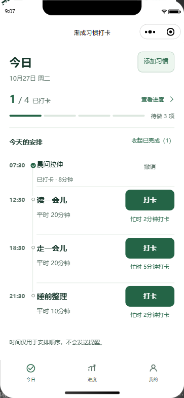
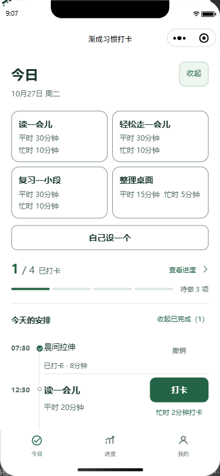
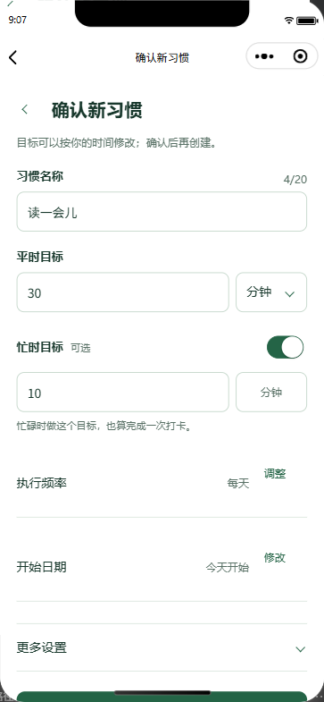
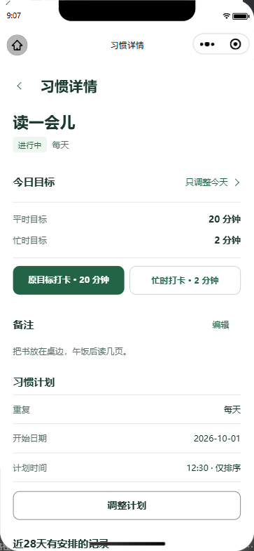
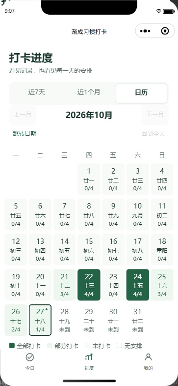

# 我做了个打卡小程序，想请大家来试试

给大家介绍一下我做的一个微信小程序，叫渐成习惯打卡。

想记录阅读、学习，或者给运动和日常整理定个计划，都可以用它。填好习惯名称，定下每次做多少，做完以后来打个卡。过几天再翻翻，看看自己做了多少。

每天安排了哪些习惯、已经完成几项、还有多少没做，都可以查看。

做完一项就打个卡，点错了可以撤销。

填了计划时间，习惯就会按时间排好。

第一次添加习惯，可以从现成的模板里选。现在有阅读、走路、复习和整理桌面，选中以后，名称和目标都能改。也可以直接自己设一个。

每次做多少，可以按分钟、页或次来记。每周哪几天做，自己选，每天做或只选周一到周五都可以。

每个习惯还可以设一个忙时目标。平时按原来的计划做，忙的时候，完成较小的那个目标，也能记一次打卡。回看进度时，能知道哪些是按原目标完成的，哪些是按忙时目标完成的。

有时只想少做一天，用“只调整今天”把当天目标调小就行。改完目标，再去做，做完再打卡，平时的计划不用跟着改。

如果之后都想换个安排，就编辑习惯计划，修改从明天生效，今天和过去的记录保留。暂时顾不上了，也可以先暂停，以后再恢复。

打卡以后，可以回看近7天和最近30天的进度。每天安排了几项、完成了几项，按原目标和忙时目标各完成多少次，都有统计。今天还没过完，打卡率就先算到昨天。

想找某一天的记录，就切到日历，点开那个日期。那天安排过什么、完成了什么，都能查。休息日、暂停期间和还没开始的日子，不算漏做。

每个习惯当天还能留一条最多140字的备注，写点自己以后想回看的内容。再翻到这一天时，备注也在。

欢迎来试试渐成习惯打卡小程序，先放一个你想做的习惯进去，用几天看看。哪里用着别扭，或者还缺什么，欢迎在文章下方留言，小程序“我的”页也有反馈入口。
